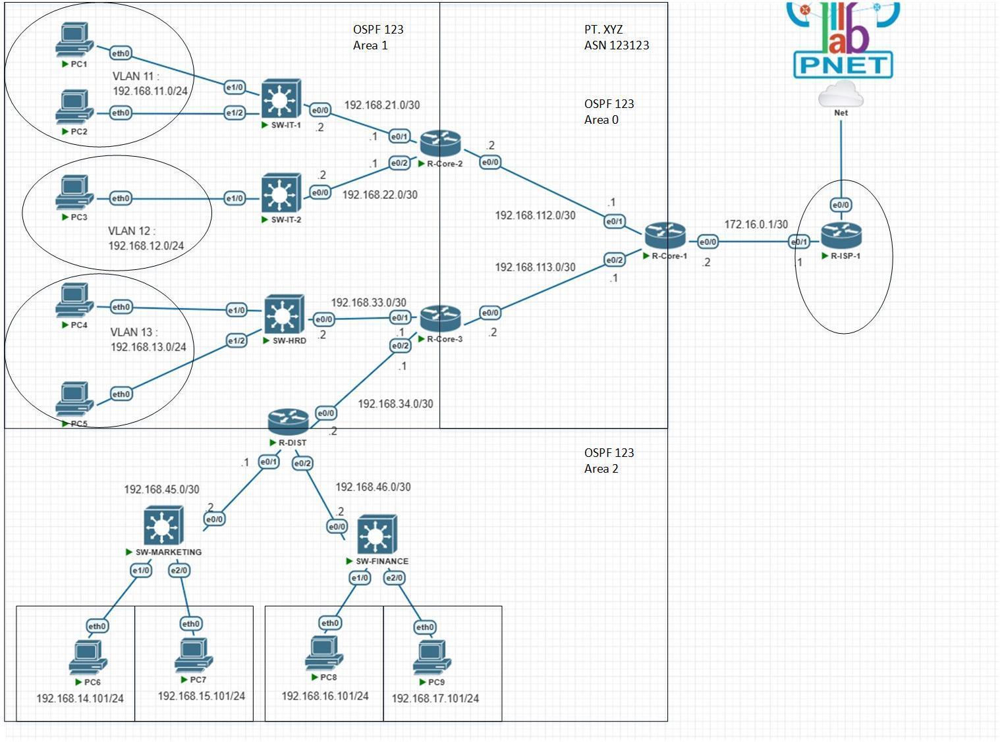
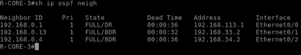
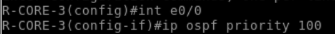
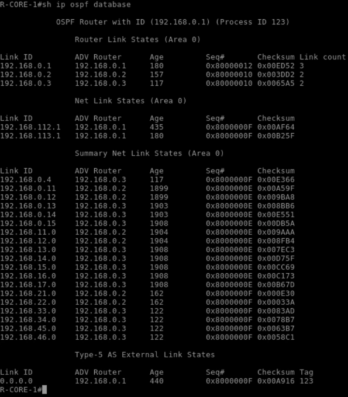
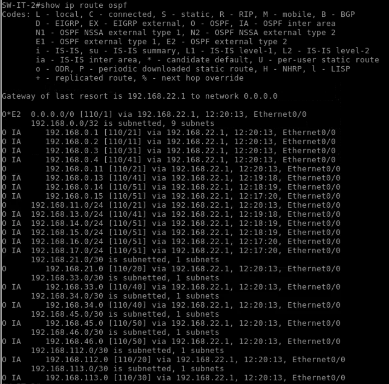
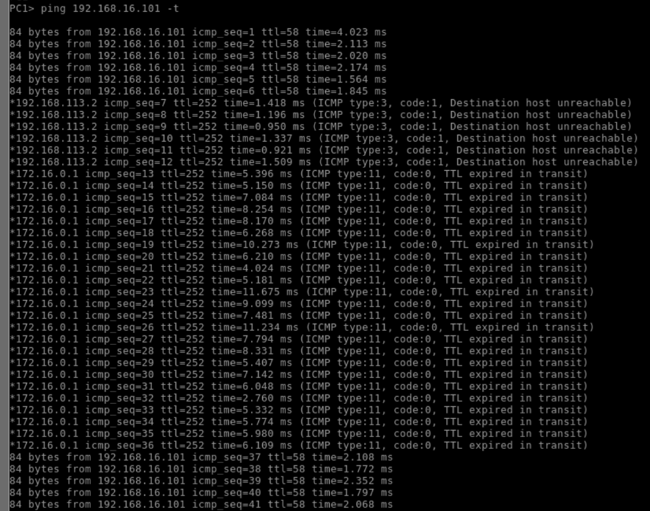
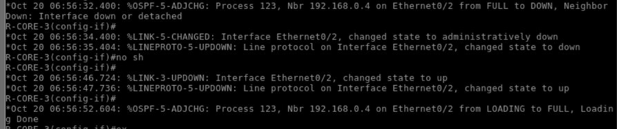

# Enterprise Multi-Area OSPFv2 Routing & VLAN Infrastructure on Cisco IOL (PNETLab)

[](https://www.cisco.com/)
[](https://pnetlab.com/)
[-success)]()
[]()

Repositori ini memuat dokumentasi arsitektur jaringan enterprise, perancangan topologi bertingkat (*Core-Distribution-Access*), pemodelan protokol perutean dinamis **OSPFv2 Multi-Area**, segmentasi lalu lintas menggunakan **Virtual LAN (VLAN)**, serta rekayasa failover jalur data pada simulator **Cisco IOL** di lingkungan **PNETLab**.

Proyek praktikum ini diselesaikan pada mata kuliah *Infrastruktur & Layanan Jaringan Internet*, Program Studi D4 Teknik Telekomunikasi, Jurusan Teknik Elektro, **Politeknik Negeri Bandung (POLBAN)**, di bawah bimbingan dosen pengampu:
* **Taufik Irfan, S.ST., M.T.**
* **M. Soebagja, S.T., M.T.**

---

## 👥 Tim Pelaksana & Pembagian Peran Teknis (Kelompok 2 / Kelas 3A-TNK)

Proyek ini dibangun secara kolaboratif oleh 4 insinyur jaringan dengan pembagian perangkat router inti dan switch departemen:

| Anggota Tim | NIM | Perangkat yang Dikonfigurasi | Peran & Tanggung Jawab Teknis |
|:---|:---:|:---|:---|
| **Andrean Noviansyah** | 241344004 | `R-ISP-1`, `R-CORE-1` | Konfigurasi Gateway ISP-1, OSPF Area 0, BDR Router Core |
| **Azlan Abdurahman** | **241344006** | **`R-CORE-3`, `SW-HRD`** | **Konfigurasi ABR Core-3, OSPF Area 0/Area 1, Tuning DR Priority, Routing Switch HRD & Inter-VLAN** |
| **Jihan Nabila Nurhidayat** | 241344013 | `R-CORE-2`, `SW-IT` | Konfigurasi Core-2, OSPF Area 0/Area 2, Switch Distribusi IT |
| **Keysa Kalam Setiadi** | 241344014 | `R-ISP-2`, `SW-FINANCE` | Konfigurasi Gateway ISP-2, OSPF External Routing, Switch Finance |

---

## 🗺️ Desain & Arsitektur Topologi Jaringan

Arsitektur jaringan enterprise dirancang dengan hierarki *hierarchical internetworking model* untuk menjamin skalabilitas, isolasi domain broadcast, dan ketahanan terhadap titik kegagalan tunggal (*Single Point of Failure*).

<p align="center">
  
  <br/>
  <em>Gambar 1: Diagram topologi jaringan enterprise pada simulator PNETLab. Memperlihatkan interkoneksi Backbone OSPF Area 0, Area 1 (HRD), Area 2 (IT/Finance), segmentasi VLAN 11 s/d 17, dan dual-homed upstream ke ISP-1 dan ISP-2.</em>
</p>

### Parameter Segmentasi & Pengalamatan IP:
* **OSPF Area 0 (Backbone Core):** Interkoneksi mesh segitiga antara `R-CORE-1`, `R-CORE-2`, dan `R-CORE-3`.
* **OSPF Area 1 (Divisi HRD):** Subnetting `192.168.11.0/24`, `192.168.12.0/24`, dan `192.168.13.0/24`.
* **OSPF Area 2 (Divisi IT & Finance):** Subnetting `192.168.14.0/24` s/d `192.168.17.0/24`.
* **Identitas Router (Loopback / Router-ID):**
  * `R-CORE-1`: `192.168.0.1/32`
  * `R-CORE-2`: `192.168.0.2/32`
  * `R-CORE-3` (Azlan): `192.168.0.3/32`

---

## 🔬 Rekayasa Teknis & Verifikasi Laboratorium

### 1. Formasi Adjacency OSPF & Pemilihan DR/BDR
Pada segmen broadcast multi-access, router dikonfigurasi dengan prioritas khusus untuk mengendalikan pemilihan *Designated Router* (DR) dan *Backup Designated Router* (BDR):
* Menyetel `ip ospf priority 100` pada `R-CORE-3` dan `ip ospf priority 200` pada `R-CORE-1` untuk menjamin stabilitas topologi backbone.
* Tabel tetangga OSPF (`show ip ospf neighbor`) menunjukkan status konvergensi penuh `FULL/DR` dan `FULL/BDR`.

<p align="center">
  
  
  <br/>
  <em>Gambar 2: Kiri: Tabel ketetanggaan OSPF pada router R-CORE-3 (Azlan) yang menunjukkan status FULL dengan router tetangga. Kanan: Penyesuaian metrik 'ip ospf priority' pada antarmuka Ethernet.</em>
</p>

### 2. Pangkalan Data Link-State (LSDB) & Tabel Routing Antar-Area
Router `R-CORE-3` bertindak sebagai *Area Border Router* (ABR) yang meneruskan LSA Tipe 1 (Router LSA), Tipe 2 (Network LSA), dan Tipe 3 (Summary LSA) antar-area:
* Verifikasi LSDB (`show ip ospf database`) membuktikan penyebaran informasi rute topologi antar-area berjalan serempak tanpa adanya rute tersembunyi.
* Tabel routing (`show ip route ospf`) mengonfirmasi bahwa setiap subnet departemen dapat dijangkau melalui jalur berbiaya terendah (*lowest cost path*).

<p align="center">
  
  
  <br/>
  <em>Gambar 3: Kiri: Pangkalan data LSA (LSDB) pada router inti. Kanan: Tabel routing dinamis OSPF yang terdistribusi ke seluruh switch layer 3.</em>
</p>

### 3. Uji Redundansi Jalur & Failover Transmisi Data
Untuk memvalidasi keandalan jaringan terhadap potensi putusnya kabel (*link failure*):
* Dilakukan pengujian transmisi paket kontinu (`ping -t`) dari host `PC1` (Divisi HRD) menuju host `192.168.16.101` (Divisi IT).
* Ketika antarmuka salah satu router backbone dimatikan secara sengaja, syslog mencatat `%OSPF-5-ADJCHG: Nbr DOWN`, dan algoritma SPF (*Shortest Path First*) langsung menghitung rute alternatif sekunder. Transmisi pulih secara otomatis dengan *packet loss* sesaat yang minimal.

<p align="center">
  
  
  <br/>
  <em>Gambar 4: Kiri: Pengujian ping end-to-end dengan verifikasi redundansi jalur alternatif. Kanan: Notifikasi syslog router saat terjadi transisi perubahan topologi jaringan.</em>
</p>

---

## 📂 Struktur Repositori

```text
├── docs/
│   └── Laporan_Praktikum_OSPF_VLAN_Kelompok2.pdf   # Laporan resmi lengkap praktikum (PDF)
├── configs/
│   ├── R-CORE-3_Azlan.cfg                         # Running-configuration Router R-CORE-3 (Azlan)
│   └── SW-HRD_Azlan.cfg                          # Running-configuration Switch SW-HRD (Azlan)
├── assets/
│   ├── topology/
│   │   └── pnetlab_full_topology.png              # Diagram arsitektur topologi PNETLab
│   └── verification/                              # Bukti verifikasi laboratorium PNETLab
│       ├── 01_r_core_3_ospf_neighbor.png          # Tabel tetangga OSPF R-CORE-3
│       ├── 02_ospf_database_lsdb.png              # Link-State Database (LSDB)
│       ├── 03_routing_table_ospf.png              # Tabel routing terkonvergensi
│       ├── 04_ospf_priority_tuning.png            # Penyetelan prioritas DR/BDR
│       ├── 05_end_to_end_ping_failover.png        # Pengujian konektivitas & failover ping
│       └── 06_ospf_adjchg_syslog.png              # Catatan syslog transisi adjacency
└── README.md
```

---

## 🛠️ Ringkasan Cuplikan Konfigurasi Kunci (R-CORE-3)

```cisco
! Konfigurasi Identitas & Loopback Gateway
hostname R-CORE-3
interface Loopback0
 ip address 192.168.0.3 255.255.255.255
!
! Konfigurasi OSPF Multi-Area Backbone & HRD
router ospf 123
 router-id 192.168.0.3
 network 192.168.0.0 0.0.0.255 area 0
 network 192.168.10.0 0.0.0.255 area 1
!
! Penyetelan Prioritas DR Backbone pada Interface Ethernet
interface Ethernet0/0
 ip ospf priority 100
 no shutdown
```
